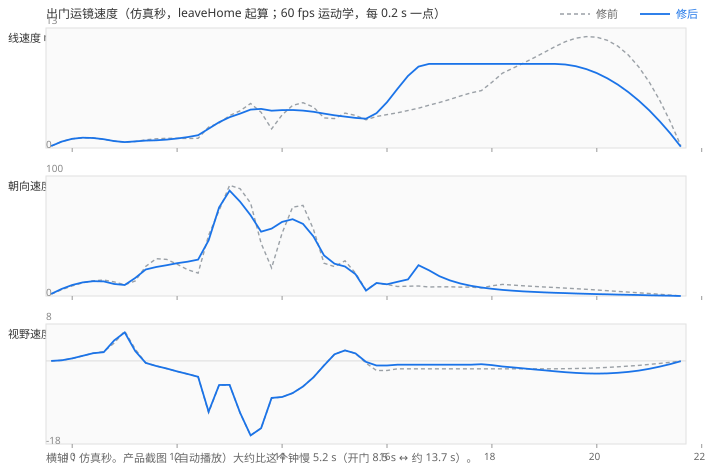

# RESULT：出门运镜节奏

分支 `cursor/exit-camera-pace-a0c7` → Pull Request 到 `int/v1`（草稿，未合并，没有推到 `int/v1`）。

产品第 6 轮：白天出门这一段（开门、跨门槛、沿路跟拍、摆到正面、升到海岛全景）走着走着会突然加快，没有平滑过渡。人没有停下来等镜头。

## 原因

出门是 `leaveHome` 里 opening-door 之后的一条 span：`outCrossing` + `toIsland` + crane settle（`cameraTracks.outbound`，pchip，easeIn 0.08，easeOut 0.2）。

两处速度接不上，都在这条 span 上：

1. **摆到正面。** `railOut` 五个姿势交给逐分量 pchip 时，转向那根轴的相邻斜率变号，切线被置 0。镜头线速度在仿真 13.4–14.4 s 从 **4.82 → 2.06 → 4.91 m/s**（朝向同时 **77 → 23 → 76 °/s**）。弦速度本来就在 3.6 m/s 左右，这个谷是插值造出来的，不是关键帧之间的距离和时间不成比例。
2. **升镜。** 等弧长步长只走到轨道一半，她停下之后剩下约 32 m 是 settle 上的**一段** Hermite。速度从约 3 m/s 爬到 **12.08 m/s**（19.8 s），再被 ease-out 收到 0。

另外试过把视野也放进同一条向心样条。位置弧长连续之后，铁路关键帧上视野曲率的台阶被走得太快，视野速率在 13.78 s 附近一帧从约 −14 °/s 收到 −9 °/s（**dfv ≈ 230 °/s²**，修前全程最大是 84）。视野改回沿 span 进度的标量 pchip，关键帧上的 fov 不变。

## 改了什么

只动出门这一段的镜头节奏。

- `FirstsliceRoutes.paceOutbound`：向心 Catmull-Rom 穿过原来的 span 关键帧（跨出门、`railOut`、等 u 的 crane 步、`cameraIsland`）。摆镜之前用弧长对进度的标量 pchip 取样，每个关键帧仍落在原来的走路进度上（正面 0.43、crane `startProgress` 0.553、风的键不动）。crane 起点之后用 1.2 s 的 smoothstep 从跟拍速度接到巡航速度，原有 ease-out 仍收到静止。视野是关键帧 fov 对 span 进度的标量 pchip，不再走那条向心样条。
- `WorldFlowCore.leaveHome`：有 `cameraSettle` 时，升镜关键帧记在 settle 时钟上（最后一帧仍是 `cameraIsland`），`cameraToIsland` 停在她停下那一刻的姿势，不再把整段升镜收成一个 Hermite 段。
- `RegionCameraData.crane.pace`：`sampleMetres: 0.15`，`craneRampSeconds: 1.2`。`startProgress`、`settleSeconds`、`steps`、`railOut`、`windOut`、门的角度都没改。

没有改回家、风的含义（出门变大，摆到正面时为 1）、门的开合、角色、`CharacterMotion.ts`、角色 GLB、裙子、门的网格、道具、棋盘。

她的走路时长没变（`outCrossing` 2.839 s，`toIsland` 6.263 s，settle 2.992 s）。镜头进度仍跟距离走，人不等镜头。

## 修前 / 修后

钟是 `leaveHome` 起算的仿真秒（60 fps，`tools/camera-frame-test` 的运动学：位置 m/s、朝向 °/s、视野 °/s）。产品截图相对自动播放，大约比这个钟晚 **5.2 s**（开门仿真 8.52 s ↔ 截图约 13.7 s）。下表不改采样，只对齐同一条钟。

图（灰虚线修前，蓝线修后；每 0.2 s 一点，9.6–21.6 s）：



摆到正面那一段（产品看到的突然加快）和后面的升镜：

| t (s) | 修前线速度 | 修后 | 修前朝向 | 修后 | 修前视野 | 修后 |
|---:|---:|---:|---:|---:|---:|---:|
| 12.4 | 1.05 | 1.39 | 19.1 | 30.3 | −3.39 | −3.45 |
| 12.6 | 2.27 | 2.09 | 50.6 | 46.3 | −11.20 | −11.00 |
| 12.8 | 2.71 | 2.79 | 71.2 | 73.8 | −5.22 | −5.21 |
| 13.0 | 3.51 | 3.33 | 92.3 | 87.8 | −5.19 | −5.19 |
| 13.2 | 4.03 | 3.72 | 89.4 | 78.6 | −11.29 | −11.25 |
| 13.4 | 4.82 | 4.16 | 77.4 | 67.2 | −16.13 | −16.13 |
| 13.6 | 3.87 | 4.24 | 44.0 | 53.6 | −14.58 | −14.57 |
| 13.8 | **2.06** | **4.04** | **23.4** | **56.2** | −8.09 | −8.01 |
| 14.0 | 3.58 | 4.11 | 52.4 | 61.7 | −7.82 | −7.82 |
| 14.2 | 4.62 | 4.11 | 74.0 | 64.0 | −6.98 | −6.98 |
| 14.4 | 4.91 | 4.05 | 75.5 | 60.1 | −5.55 | −5.54 |
| 14.6 | 4.43 | 3.92 | 55.4 | 49.6 | −3.53 | −3.54 |
| 14.8 | 3.26 | 3.73 | 27.4 | 33.9 | −0.94 | −0.99 |
| 15.0 | 3.19 | 3.55 | 24.5 | 26.9 | 1.43 | 1.44 |
| 15.2 | 3.78 | 3.40 | 29.3 | 24.6 | 2.28 | 2.27 |
| 15.4 | 3.53 | 3.26 | 19.0 | 18.2 | 1.62 | 1.63 |
| 15.6 | 3.06 | 3.17 | 5.1 | 4.5 | −0.48 | −0.21 |
| 16.0 | 3.62 | 4.96 | 9.6 | 9.8 | −2.07 | −0.99 |
| 16.4 | 4.06 | 7.81 | 8.2 | 13.9 | −1.70 | −0.81 |
| 16.8 | 4.63 | 9.11 | 7.5 | 21.4 | −1.70 | −0.81 |
| 17.6 | 5.97 | 9.11 | 7.4 | 8.5 | −1.70 | −0.81 |
| 18.4 | 8.64 | 9.11 | 9.1 | 4.4 | −1.70 | −1.41 |
| 19.2 | 10.97 | 9.11 | 7.0 | 2.7 | −1.70 | −2.25 |
| 19.8 | **12.07** | 8.55 | 5.5 | 1.9 | −1.60 | −2.70 |
| 20.6 | 10.08 | 6.06 | 3.3 | 1.0 | −1.13 | −2.38 |
| 21.6 | 0.26 | 0.14 | 0.1 | 0.0 | −0.03 | −0.06 |

60 fps 上出门段（`crossing-out`）的极值：

| | 修前 | 修后 |
|---|---|---|
| 线速度 | 最大 12.08 m/s（19.8 s）；13.4–14.4 s 有 4.82 → 2.06 → 4.91 的谷 | 最大 9.11 m/s，13.4–14.4 s 停在 4.04–4.24，0.2 s 采样没有这种谷 |
| 朝向 | 同一段 77 → 23 → 76 °/s；\|dw\| 最大 274 °/s²（12.75 s） | 同一段 67 → 54 → 60 °/s；\|dw\| 最大 286 °/s²（13.133 s，铁路关键帧上一帧曲率台阶，阈值 360） |
| 视野 | \|dfv\| 最大 84 °/s²（12.45 s） | \|dfv\| 最大 86 °/s²（12.533 s）。向心样条造成的一帧 230 °/s² 已去掉。关键帧之间的弦速率（约 −5 到 −16 °/s）和修前一样，那是这几个 fov 关键帧本身的间距 |
| 线加速度 | \|dv\| 最大 13.5 m/s²（21.6 s，ease-out） | 出门段 \|dv\| 最大 8.43 m/s²（12.533 s，摆镜起步）。全片最大 12.97 m/s² 在回家起步（21.85 s），阈值 15，和这条出门改动无关 |

门槛里 10.2–11.0 s 从约 1.12 m/s 收到约 0.64 m/s，修前修后一样，是门口那段较短的弦（约 0.35 m / 0.57 s），不是外面摆镜的那个谷。关键帧时间不能挪，否则风和 crane 起点会离开走路进度。

## 没改的合同

- 风：从 `crossing-out` 起，门槛 0.483 s 开始有风，正面 **5.35 s 正好为 1**，保持到 6.033 s（0.683 s），12.1 s 回到 0，海岛停稳 12.133 s。正面夹角 13.6°（上限 25°），保持期间最大 18.5°（上限 40°）。0.4 和 0.7 各只有一次上升穿越。和修前同一条时间线。
- 门：岛上 45°，开 86.4°。没改开合角度。
- 回家进门：`return-entry-continuous` 和修前同一组数（窗口内最大线加速度 2.23 m/s²）。跟拍距离 1.826–2.469 m。
- 铁路距离：crane 开始前水平距离 2.59–5.43 m，带是 [2.0, 5.5]。
- crane 标记：仿真 15.567 s（`crossing-out` 之后 6.05 s，进度 0.553）。海岛停稳 21.65 s。

## 测试

`QF_TYPESCRIPT_MODULE` 指向本地的 TypeScript 5.6.3。

```
node tools/camera-frame-test/test_camera_frames.cjs
```

装了 `draco3d@1.5.7`（只在 `tools/camera-frame-test/node_modules`，没有进提交）之后跑的是带碰撞的全量，不是 `--no-geometry`。**ALL PASS，2518 帧。** 阈值没有放宽。碰撞最近距离 0.15 m（正好在阈值上，发生在出门之前的室内走向门口，`env_interior_props_merged`），没有第一处违规；出门段没有贴到道具。

`node tools/test_world_camera_audit.cjs` **没有跑**。它要 Playwright 打开 `http://127.0.0.1:8770/` 的运行时页面。这个环境没有 Playwright，也没有那个页面。没有为了让它通过去改断言。
