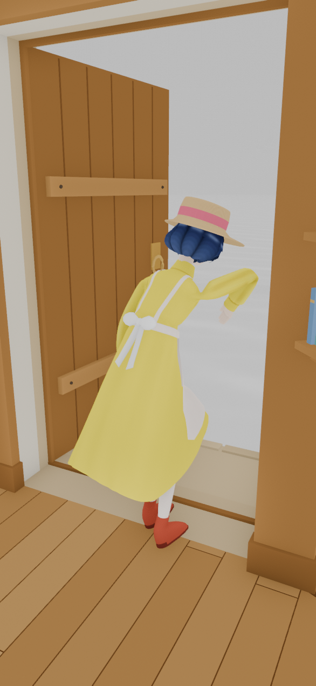
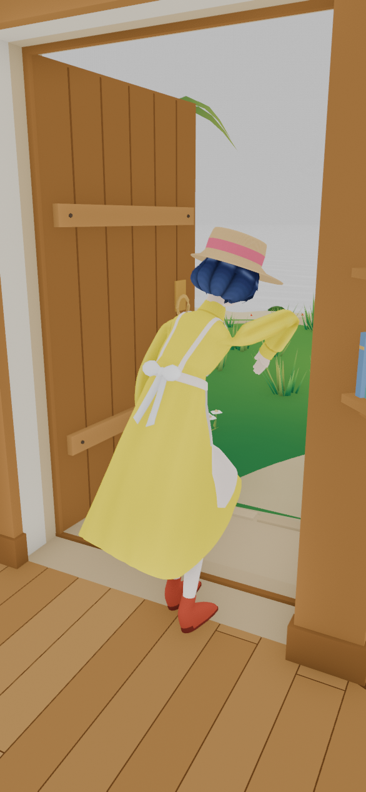
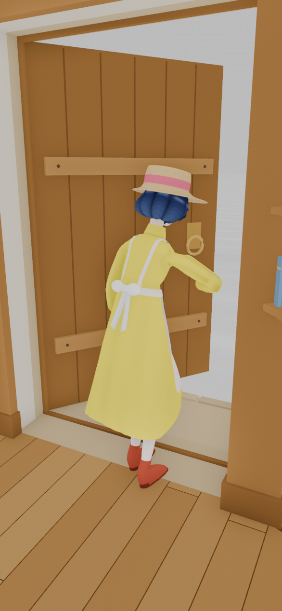
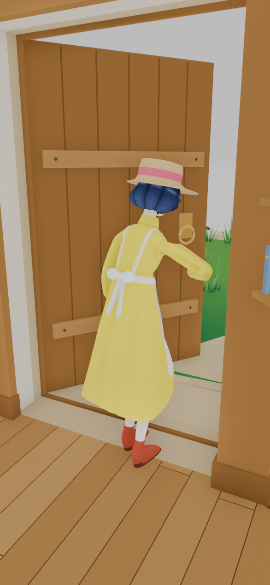

# RESULT：开门那一秒，门洞里不再是一整片海

分支 `cursor/door-open-sea-clip-f5f9` → 草稿 PR https://github.com/Funning0423/yiqifengle/pull/11 ，基线 `int/v1` @ `195159c`（出门运镜 `195159c`，坐姿冻结 `14716b7`）。没有合并，没有 push 到 `int/v1`。

## 结论

能看到海面的那一处，是门洞。`opening-door` 这一秒门扇在开，海面背景一直开着，岛和岛上的地面还关着。镜头从门洞穿出去，打在海面上。岛的地面本来会挡住这片海。

镜头没有钻进墙，也没有钻进门。手和身体没有穿过门板。

改动只有 `WorldFlowCore.leaveHome`：进入 `opening-door` 的同一拍打开 `BOTH`（室内 + 室外），室内灯光权重保持 1，然后才播这一秒的开门。门的开合角度、回程镜头、出门运镜节奏都没动。

手掌陷进围裙大约 18 mm 没有改。现有的两段 IK 能把腕骨沿世界上抬 18 mm，黄裙、围裙、蝴蝶结的顶点位移是 0，没有反弹。手掌仍然埋在围裙那一层里，左袖和围裙的相交还变多。运行时 glb 保持原样。

## 开门这一秒看到了什么

游戏镜头是 D4 / `cameraInside`：位置 `[-1.214, 1.694, -2.307]`，垂直 fov 68°，near 0.05。`door_reach` 从进入 `opening-door` 开始播。角色在 `door_stand_point`，缩放 1，朝向约 -18.4°。门铰链 `(0.720, 0, 0)`，绕 +Y 向外开到 `openDeg` 86.4°。60 fps 上这一秒是 60 帧，镜头不动。

| 检查 | 结果 |
|---|---|
| 镜头离几何 | 最近 0.150 m，打在 `env_interior_props_merged`。门扇四边形最近 0.534 m（`crossing-out`）。near 0.05，没有切进模型 |
| 身体 / 手和门板 | `door_reach` 0 / 0.33 / 0.50 / 0.63 / 0.80 / 0.98 s，门角 0° 到 85°，角色网格和门板的三角形相交都是 **0**（12,781 个顶点） |
| 门洞光线（0.63 s，门 54.7°，40×40） | 岛钻进室内：**0**。门外地面比海面近、关着岛就会露出海：**142**。岛后面的真地平线：**17** |
| 门角 0° | 门板盖住门洞，这一帧还没有那片海 |

手停在关上时的把手位置，门扇向外转开。画面上手臂和门板叠在一起，网格没有相交。海是门洞里空出来的那一块，不是从身体或门板的裂缝里漏出来的。

## 改了什么

`creator-build-project/assets/scripts/world-r1/WorldFlowCore.ts` 的 `leaveHome`。原来是门开完才 `setLayers(BOTH)` 并 `setRoomLightWeight(1)`。现在这两句和 `change('opening-door')` 在同一步，`await animateDoor(0, openDeg, 1)` 还在后面。`crossing-out` 仍在这一秒结束之后。

`BOTH` 就是过门槛之后本来就要用的那一组：室内、室外、门、背景都开。海面、天空仍是背景。岛、岛上道具、棕榈和 `_v22` 的日间网格跟着室外一起出现，把门洞里那 142 条光线挡住。剩下的 17 条是岛外面的海，开着的门就该看到。

回程仍是原来的 `setLayers(BOTH)`，有 `interiorLighting` 时权重写 0。`openDeg` 仍是 86.4。`FirstsliceRoutes.paceOutbound`、`RegionCameraData.crane.pace` 没改。`STANCE_MM` 没改。骨骼名、层级、IBM、运行时 glb 没改。

`node tools/test_manifests.cjs --write` 重写了 `text-MANIFEST-SHA256.json`。`WorldFlowCore.ts` 是这次改的。`FirstsliceRoutes.ts` 和 `RegionCameraData.ts` 的正文就是 `int/v1` 上已经合进来的出门运镜，清单里的旧哈希对不上，这次一并记上。这两个文件本身没有再改。

## 修前修后

Workbench，`FLAT` + 贴图，竖屏 586×1266，游戏镜头四元数，角色缩放 1。修前按室内层：室外关，灯塔外壳仍开，海面背景开。修后按 `BOTH`：岛和室外道具开。

门开到约 85°（这一秒的最后一帧，0.98 s）：

手贴把手的那一帧（0.63 s，门约 55°，`door_reach` 接触点 0.633 s）：

修后画面上方还有一条浅色的海。那是岛外面的地平线，对应上面的 17 条光线。门洞里原先一整片灰海换成了草地。

## 手

坐稳帧（`sit_hold` 第 0 秒，`sit_drape` 权重 1）左手穿进围裙的顶点，深度 p95 是 **18.86 mm**（最深 31.37 mm）。右手最深 33.42 mm。手-围裙三角形 135 / 215 对，袖-围裙 35 / 25 对。

用现有的 `art-src/animation/sit-still/scripts/freeze_hold.py --lift 0.018` 写到 `/tmp/sit-lift.glb`，没有覆盖运行时 glb。两只手腕沿世界 +Y 各走了 18.0 mm，手掌朝向变化 0°。黄裙、围裙、蝴蝶结的顶点位移低于 1e-6 mm，脚本没有因为布料移动而退出。腿-黄裙、腿-围裙、围裙-黄裙仍是 0。其他片段（含 `door_reach`）局部姿态差是 0。

手没有因此到围裙上面：

| | 改前 | 抬 18 mm |
|---|---|---|
| 手-围裙 L / R | 135 / 215 | 165 / 128 |
| 袖-围裙 L / R | 35 / 25 | 84 / 29 |
| 左手穿入最深 / p95 | 31.37 / 18.86 mm | 30.82 / 20.74 mm |
| 右手穿入最深 | 33.42 mm | 55.84 mm |

布料没有反弹。手是嵌在围裙那一层里面，只抬腕骨出不来，左袖的相交还变多。按「抬高会让布料反弹就停下」，这一次布料没动，但手掌没有抬出围裙，所以没有收进运行时 glb。坐姿方案、`sit_drape` / `sit_hold` 冻结都没改。运行时 glb 仍是 **1,373,744 B**。

## 测试

| 命令 | 结果 |
|---|---|
| `node tools/t5/test_room_light_blend.cjs` | 19/19。A5 灯光段落哈希没变。A6 调用点没增没减。A7：出门的 `layers:BOTH` 下一步仍是 `w:1`。E1：权重单步 ≤ 0.006，岛上落到 0，回家落到 1 |
| `node tools/camera-frame-test/test_camera_frames.cjs` | 2518 帧全部通过。镜头净空 0.15 m，门扇净空 0.534 m，回程亮度通过，`openDeg` 86.4，出门轨道和起重机时刻没有被拉开 |
| `node tools/camera-frame-test/test_door_spill.cjs` | 通过。室外提前一秒打开后，门缝光仍在 1 秒内淡掉，岛上没有漏光 |
| `node tools/test_manifests.cjs` | 通过 |

`flow_sim` 60 fps：`opening-door` 60 帧，层是 `BOTH`，门从 0° 到最后一帧 84.96°，镜头停在 D4。`walking-out` 室外仍是关的。
