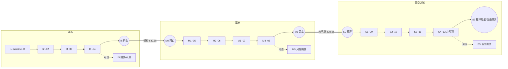
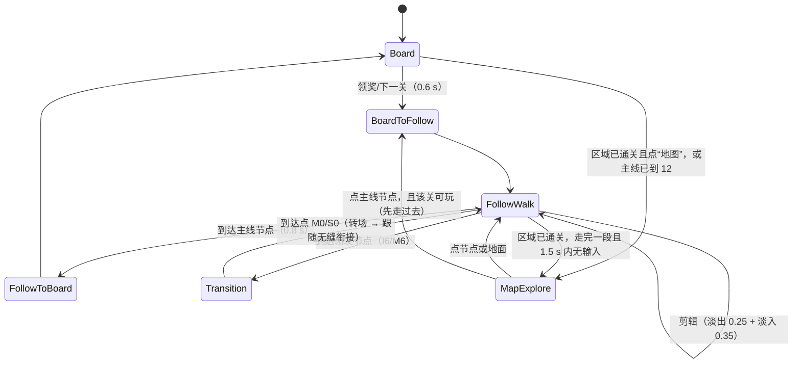
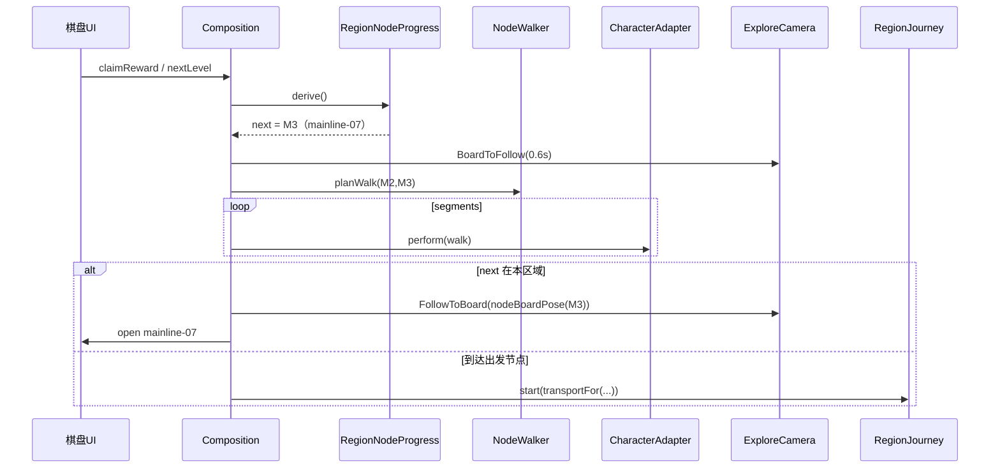

# r5 区域关卡节点 + 帆船（海岛→草地）+ 热气球（草地→天空之城）· 开发文档

版本：2026-10-17 · 基线：r4.1 `f569ff0d9eeb9f6ab26bdc56276fa234e60c5ac4` · 作者：Grok Bot（给 Cursor CLI）

本文所有坐标、长度、时长，都来自当前仓库的真实代码和真实 GLB，用 `/workspace/gh/out/maps/*.cjs` 和 `/workspace/gh/out/audit/*.cjs` 实测得到。
“→ 我们取”的数字依据见 `market-research.md §1`，引用时写作 P1…P13。

## 0. 一页摘要

- **实施顺序**：按 ① → ② → ③ 依次做，每一步各开一个分支，都从 f569ff0 起。
  1. **区域关卡节点**：`gbt/r5-region-level-nodes`，提示词见 `cli-task-region-nodes.md`。
     - 每个区域 6–7 个节点，见 §3 和三张俯视图。
     - 领完奖励或点“下一关”后：镜头从棋盘切到跟随视角（0.6 s），她走到下一个节点。单段可见走路 ≤ 7.6 s，超过 9.6 m 的段会剪一刀（P3）。
     - 到达后，镜头从跟随切到这个节点的棋盘相机（0.8 s）。
     - 区域里的主线全部通过后，开放自由探索：拖动平移、捏合缩放、点哪走哪、点物件有反馈。
  2. **帆船**：`gbt/r5-sail-island-meadow`，提示词见 `cli-task-sail.md`。
     - 路线：海岛南码头 I6 → 海上 → 草地河口 M0 → 走到 M1（mainline-05）。
     - **时长目标 24 s，上限 30.5 s**。Build05 的 04→05 是 28.5 s，上限是它加 2 s。
  3. **热气球**：`gbt/r5-balloon-meadow-sky`，提示词见 `cli-task-balloon.md`。
     - 路线：风车门前 M6 起飞 → 爬升穿过云层 → 天空之城前沿草坪 S0 降落 → 走到 S1（mainline-09）。
     - **时长目标 30 s，上限 38.9 s**。Build05 的 08→09 是 36.9 s，上限是它加 2 s。
- **彩虹桥不删，只用开关关掉**：`JOURNEY_TRANSPORT.<leg>='sail'|'balloon'|'bridge'`，见 §11。旧路线一字不改，作为 fallback 保留。
- **冻结文件不碰**：
  - 女孩的动作只用现有的 `CharacterAdapter.perform({kind:'walk'|'sit'|'stand'|'turn'})` 和现有动画片段：`sit_down` 1.2 s、`sit_hold`、`stand_up` 1.27 s、`idle_breathing_loop`、`walk_*`。
  - 骑乘时，把她的根节点挂到载具的座位节点下（`keepWorldTransform`），见 §12。
  - `CharacterMotion.ts`、`anim_meta.json`、`WorldIntegrationBoot.ts` 里的 FlowReferenceStandin 段、所有场景 GLB 都只读。
- **每一帧背景都必须完整**：
  - 新增 `tools/transitions/test_frame_background.cjs`，沿镜头路径每 0.1 s 采样一次。
  - 任一项不达标就判 FAIL：近平面穿模、背面、空洞（void）、看到城底、两个天穹接缝。
  - 现有转场的审计结果见 §8.1。
- **预算**：
  - 每个转场的新增资产 ≤ 45k 三角面（目标 ≤ 12k），分包 ≤ 1.0 MiB（目标 ≤ 0.35 MiB）。
  - 转场期间 DC 不超过当前旅途的峰值（≤ 53，与 r4 实测一致），同时稳定 60 FPS。
  - 棋盘第一帧 ≤ 16.7 ms。
  - 总包 ≤ 24,641,536 B（r4 是 19,335,755 B）。



---

## 1. 依据：代码现状（只列和本次相关的部分）

| 主题 | 现状（f569ff0） | 位置 |
|---|---|---|
| 区域之间的旅途 | `RegionJourneyController` 状态机：`idle→loading→ready→approach→bridge→arrival→arrived`（另有 paused/failed/disposed）。`createRegionJourney().prepare(from,to,start,…)` 负责加载区域 prefab，并挂到 `RegionJourney-<region>` 这个 rig 下，然后拼出路线：`approach + bridge + arrival` | `world-r1/RegionJourneyCore.ts`，`region/RegionJourneyAdapter.ts:54-135` |
| 路线和布局 | `REGION_JOURNEY_LAYOUT`：`islandApproach [0.8,0,3.2]`、`meadowOffset [0,0,24]`、`skycityOffset [18,12,0]`、`speedMps 1.2`。另有 `bridgePath`、`skyDeckRoute`、`skycityYawDeg` | `region/RegionJourneyLayout.ts` |
| 彩虹桥 | `rainbowBridge(rig,path,owned)`：7 条 `RainbowBridgeStrip0..6`，7 DC，`cullMode NONE`。04→05、08→09、海岛→湖畔三处都用到 | `RegionJourneyAdapter.ts:30` |
| 跟随镜头 | `JOURNEY_CAMERA`：后 6.6 m、侧 −2.4 m、上 3.4 m，前瞻 1.2 m，看点高 2.4 m，竖直 FOV 48°。`blendM 18`、`SETOFF_FADE {out .25, in .35}`、`JOURNEY_TIMING_LIMITS {peak 4.5 m/s, a 3 m/s²}`，可选 `JourneyTiming`（smootherstep） | `RegionJourneyCore.ts:45-79` |
| 落到棋盘 | `route.board`（`regionBoardEnd`）：路线最后一段过渡到当前屏幕的棋盘相机。`journeyBoardSource` 的映射是 J·B⁻¹。`regionGirlStand` 保证她和 UI 之间 ≥ 13 pt，`girlStandLine` 给出站位线 | `region/RegionBoardLanding.ts` |
| 棋盘背景 | `LevelBackgroundLease {frame,setVisible,setPaused?,diagnostics?,dispose}`。草地、天空之城用实时 3D 场景（层 1<<20，自带相机），海岛棋盘是一张 2D 图 `bg_island_board.jpg`（冻结）。`withRegionBoardGuest` 在棋盘副本里放一个她的定格副本 | `world-r2/LevelBackground.ts`，`WorldNativeComposition.ts:29-31` |
| 女孩 | `CharacterAdapter {advance, perform(Action), cancelAndReset(StablePose), setVisible, actionSeconds?, …}`。Action 有 `walk{path,duration,curve?}`、`sit/stand{seat}`、`turn` 三类。walk_loop 的原生速度是 0.7 m/s | `world-r1/WorldFlowCore.ts:20-51`，anim_meta（冻结） |
| 区域和关卡 | `requiresMeadowScene`：mainline-05..08、r05-meadow-*。`requiresSkycityScene`：mainline-09..12、r05-sky-*。湖畔：r04/05-lake-* | `world-r2/LevelRegion.ts` |
| 存档 | `MAINLINE_KEYS` 包括 `forest-mainline-cocos-r1-active`、`forest-v33-journey`、`forest-v3-progress`、`forest-v3-completed`。`R5_KEYS` 包括 `forest-regional-r05-*`。progression.js 冻结 | `PersistentMainlinePort.ts`，`PersistentR5Port.ts` |
| 夜间 | `DayNightContract`（`onDayNightChange`、`writeNightBlend`）。旅途里的草地会关掉 `meadow_sky_dome` 和 `meadow_far_hills`，共用世界的天空；只有夜间会显示草地天穹（`mountMeadowNightSky`） | `RegionJourneyAdapter.ts:72-78` |
| 前后台 | `ForegroundTimers` / `FOREGROUND_MAX_STEP_S`。r4.1b 的回家走路看门狗只按前台时间计时 | `world-r2/ForegroundClock.ts` |
| 点按 | `onPropTap(target,phase,info)`：海岛 3D UI 道具的点按事件（press/confirm/blocked），Voice Bot 的音效挂在这里 | `world-r2/IslandPropTaps.ts` |
| 已有概念 | 彩虹桥实现方案（§0 现状、§4 DC/包体、§8 方案 B r2）。竹筏 S2 概念单：竹筏棋盘，复用湖畔水面，预算约 38k 三角面 / 46 DC / 0.55–0.7 MiB | `product/2026-10-17/rainbow-bridge/IMPLEMENTATION.md`，`bamboo-raft-S2/CONCEPT.md` |

**冻结、只读**：
- `frozen-production-inputs.json` 里列的 311 个文件，包括：
  - `env_meadow.glb`、`env_skycity.glb`、`room_no_original_chair.glb`
  - 所有 bgm/amb/sfx
  - `CharacterMotion.ts`、`anim_meta.json`、`progression.js`、`engine.js`
- `WorldIntegrationBoot.ts` 里的 FlowReferenceStandin 段。

**结论**：场景里任何节点的显示和隐藏，只能在运行时按节点名切换，不能改 GLB。新资产一律新建文件。

---

## 2. 总体架构

```mermaid
flowchart TB
  subgraph 新模块
    RN[region/RegionNodes.ts<br/>节点+路网数据（纯数据）]
    RP[region/RegionNodeProgress.ts<br/>由现有存档推导解锁（纯函数）]
    NW[region/NodeWalker.ts<br/>路网最短路+剪辑走路计划（纯函数）]
    EC[world-r2/ExploreCamera.ts<br/>跟随/地图镜头，平移缩放限位（纯函数+薄组件）]
    EI[world-r2/ExploreInput.ts<br/>手势仲裁：点/拖/捏]
    NM[ui/NodeMarkers.ts<br/>节点标记+路线提示]
    NB[region/NodeBoardPose.ts<br/>每节点棋盘相机位姿（数据+校验）]
    TR[region/TransportLeg.ts<br/>帆船/热气球节拍时间轴（纯函数）]
    TV[region/TransportVehicle.ts<br/>载具节点+座位+骑乘挂接]
    BG[region/TransitBackdrop.ts<br/>天穹/云层/海平线/远景卡统一管理]
    FL[region/JourneyTransport.ts<br/>JOURNEY_TRANSPORT 开关]
  end
  subgraph 现有（改动小）
    RJA[RegionJourneyAdapter.prepare]
    RJC[RegionJourneyController]
    WNC[WorldNativeComposition<br/>advanceMainline/enterMainline]
    RBL[RegionBoardLanding]
    LBG[Meadow/SkycityBoardBackground]
  end
  subgraph 冻结（只读）
    CM[CharacterMotion / anim_meta]
    FRS[FlowReferenceStandin]
    GLB[env_*.glb]
  end
  WNC--领奖/下一关-->NW
  NW--Action walk-->FRS
  RP--解锁态-->NM
  EI--点节点-->NW
  EI--拖/捏-->EC
  NB--节点棋盘相机-->LBG
  RBL--J·B⁻¹-->NB
  FL--sail/balloon/bridge-->RJA
  RJA--路线+节拍-->TR
  TR--时间轴-->RJC
  TV--seat/挂接-->FRS
  BG--每帧背景-->RJA
```

**分层原则**（沿用仓库现有约定）：
- `*Core` 和纯数据模块不依赖 `cc`，可以直接在 Node 里测试。
- 组件层只负责把纯函数的结果写到节点上。
- 所有新模块**不引用** FlowReferenceStandin 的内部实现，只通过 `CharacterAdapter` 接口。

---

## 3. 区域节点（真实几何）

**数据怎么来的**：
- 用 `maps/topmap.cjs` 把三个区域 GLB 的真实三角形栅格化成 2.5D 可走网格：
  - 海岛 0.2 m 一格，草地和天空之城 0.4 m 一格。
  - 可走的条件：法线 y > 0.8，相邻格高差 ≤ 0.35 m，上方 1.7 m 内没有遮挡。
- 在网格上用 A* 求出各段长度，结果写在 `maps/nodes.json`。
- 坐标都在**区域模型自己的坐标系**里，海岛就是世界坐标。运行时还要乘上区域根节点的世界矩阵：旅途副本用 rig 的矩阵，棋盘副本经 `journeyBoardSource` 映射。

| 区域 | 俯视图 | 节点 | 可走总长 |
|---|---|---|---|
| 海岛 | `maps/map_island.png` | I1–I6 | 57.6 m |
| 草地 | `maps/map_meadow.png` | M0–M6 | 57.8 m |
| 天空之城 | `maps/map_sky.png` | S0–S6 | 97.4 m |

### 3.1 节点表

| 节点 | 区域坐标 (x,y,z) m | 角色 | 关卡 id |
|---|---|---|---|
| I1 | (−2.1, 0, 5.3)，门前小径尽头 = exit_path_17 | 主线 | mainline-01 |
| I2 | (2.5, 0, 8.1)，潮池 | 主线 | mainline-02 |
| I3 | (8.1, −0.36, 6.1)，东滩 | 主线 | mainline-03 |
| I4 | (4.5, 0.23, −4.9)，灯塔脚 | 主线 | mainline-04 |
| I5 | (−4.5, 0.13, −0.9)，西岬棕榈 | 可选：挑战入口/观景点 | 打开现有的挑战入口，不新增关卡 |
| I6 | (−1.9, −0.6, 10.1)，南码头 | 出发点 | 帆船 |
| M0 | (0.2, 1.22, 20)，河岸 = walk_path_00 | 到达点 | — |
| M1 | (2.6, 2.2, 11.6)，walk_path_04 | 主线 | mainline-05 |
| M2 | (−1.4, 3.19, 1.2)，walk_path_09 | 主线 | mainline-06 |
| M3 | (−3, 4, −8.4)，walk_path_13 | 主线 | mainline-07 |
| M4 | (3, 5.84, −16.4)，walk_path_17 | 主线 | mainline-08 |
| M5 | (6.6, 6.47, −21.2)，bell_tap_stand_point | 可选：挑战 | r05-meadow-01..04 的入口 |
| M6 | (0.2, 6.5, −25.6)，风车门前 | 出发点 | 热气球 |
| S0 | (5.4, −0.11, 43.8)，前沿草坪（方案 B r2 的落点区域，`SKYCITY_B2.arrivalBoard`） | 到达点 | — |
| S1 | (0.2, 0.04, 30.2)，星庭 | 主线 | mainline-09 |
| S2 | (−6.6, −0.05, 19)，西花园 | 主线 | mainline-10 |
| S3 | (6.2, −0.01, 8.2)，东台地 | 主线 | mainline-11 |
| S4 | (0.2, 3.31, −5.8)，台阶顶（+3.3 m） | 主线 | mainline-12 |
| S5 | (0.2, 0.08, −17)，巨树下 | 可选：挑战 | r05-sky-01..04 的入口 |
| S6 | (0.2, 0.03, −27.8)，星环观景 | 终点 | 自由探索 |

### 3.2 各段实测长度（A*，1.2 m/s）

| 段 | 长度 m | 不剪时 s | 处理方式 |
|---|---|---|---|
| I1→I2 | 5.8 | 4.8 | 直接走 |
| I2→I3 | 6.5 | 5.5 | 直接走 |
| I3→I4 | 13.2 | 11.0 | 剪一刀，7.6 s |
| I4→I6 | 由工具重算（经 I5 是 32.1） | — | 剪一刀，7.6 s |
| M0→M1 | 9.4 | 7.8 | 直接走 |
| M1→M2 | 12.1 | 10.0 | 剪一刀 |
| M2→M3 | 10.3 | 8.6 | 剪一刀 |
| M3→M4 | 10.5 | 8.7 | 剪一刀 |
| M4→M6 | 由工具重算（经 M5 是 15.5） | — | 剪一刀 |
| S0→S1 | 16.1 | 13.4 | 剪一刀 |
| S1→S2 | 14.0 | 11.7 | 剪一刀 |
| S2→S3 | 19.0 | 15.8 | 剪一刀 |
| S3→S4 | 16.8，爬升 +3.3 | 14.0 | 剪一刀 |
| S4→S6 | 由工具重算 | — | 剪一刀 |

**剪辑规则（P3）**：
- 段长 L ≤ 9.6 m：直接走完，L/1.2 s。
- 段长 L > 9.6 m：先走 3.5 s（4.2 m），淡出 0.25 s，在黑场里把她瞬移到“终点前 4.2 m”，淡入 0.35 s，再走 3.5 s。
- 瞬移通过 `cancelAndReset({kind:'standing',…})` 完成，然后再发一次 walk。
- 所以任何一段可见的走路都 ≤ 7.6 s。
- 一段走路中点任意位置：直接按剪辑方式跳到终点前 1.2 m，再走 1 s。

**天空之城的“继续爬升”**：
- 实测天空之城可走的顶面基本是平台（y≈0，z 从 36 到 −38），只有台阶基座能到 +3.3 m。
- 树冠在 y 30 以上，星环在 y 20，**都不能走**。
- 所以“攀升”用三种方式表现，**不新建可走几何**：
  1. 由南向北深入城市：S1→S6，跨度 58 m。
  2. 台阶顶 S4 是全区最高的可走点。
  3. 每段到达时，镜头向上抬 8°，露出前方的巨树和星环，作为目标。
- S6 终点镜头仰望星环，然后开放自由探索。

### 3.3 数据格式 `region/RegionNodes.ts`（纯数据，不依赖 cc）

```ts
export type NodeRole='mainline'|'optional'|'arrival'|'departure'|'finale';
export type RegionNode=Readonly<{key:string;region:'island'|'meadow'|'skycity';at:Vec;role:NodeRole;stageId?:string;opens?:'challenge-meadow'|'challenge-sky'|'challenge-island';
  /** 到达时她的朝向（度，atan2(x,z)），以及棋盘位姿 id */ faceDeg:number;boardPose?:string}>;
export type RegionEdge=Readonly<{a:string;b:string;path:readonly Vec[];lengthM:number}>; // path 由工具离线烘焙（A* 网格→简化折线，≤0.15 m 偏差）
export const REGION_NODES:Readonly<Record<'island'|'meadow'|'skycity',{nodes:readonly RegionNode[];edges:readonly RegionEdge[];exploreBox:readonly [number,number,number,number]}>>;
```

- 烘焙脚本 `tools/region-nodes/bake-region-nodes.cjs` 读 GLB（海岛先用 decode-draco-blender 解压），输出这个 TS 文件和 `region-nodes.json`。
- 测试会核对 TS 里的数据和重新烘焙的结果完全一致，并钉住 GLB 的 SHA。

---

## 4. 镜头状态



| 状态 | 位姿来源 | 参数 |
|---|---|---|
| Board | 节点棋盘位姿 `NodeBoardPose`，见 §4.3 | 和现有棋盘一致。海岛仍是 2D 图 |
| BoardToFollow | 从当前棋盘相机（经 J·B⁻¹ 映射到世界）到 `followPose` | 0.6 s，smootherstep；FOV 线性插值到 48° |
| FollowWalk | `followPose`（JOURNEY_CAMERA 现有参数） | 转向 ≤ 20 °/s。到达前 4.2 m 开始抬头 8°（只在天空之城） |
| FollowToBoard | 复用 `boardEndBlend` | 0.8 s，或者最后 1.0 m 的距离域过渡，取两者中较长的 |
| MapExplore | 斜俯视：pitch 52°，FOV 48°，焦点 = 她，或拖动后的焦点 | 距离 = 跟随镜头距离 7.4 m 的 0.7–1.6 倍。焦点限制在 `exploreBox` 外扩 6 m 内（P5）。惯性每秒衰减 0.9。超出边界回弹 0.25 s |
| Transition | `TransportLeg` 的节拍镜头，见 §9 和 §10 | 首帧等于 FollowWalk 的末帧，末帧等于目的地 FollowWalk 的首帧，两头位姿连续 |

### 4.1 七种屏幕

屏幕：390x844、414x896、360x780、375x667、390x520、320x568、768x1024。

- 竖直 FOV 固定 48°，宽屏会看到更多横向内容。
- 390x520、375x667 这类较矮的屏幕：
  - MapExplore 的最小距离提到 0.8 倍，避免她被 UI 遮住。
  - 跟随镜头的 `upM` 增加 0.4 m。
- 768x1024 屏幕：MapExplore 的最大距离提到 1.8 倍。
- 每种屏幕都要满足：她身体的投影 ≥ 0.12 屏高；她离 UI 安全区 ≥ 13 pt，沿用 regionGirlStand 的判定。

### 4.2 地图镜头范围（MapExplore 的焦点 AABB，区域坐标）

| 区域 | x | z | 说明 |
|---|---|---|---|
| 海岛 | −15 … 19 | −16 … 18 | 可走区域外扩 6 m |
| 草地 | −30 … 30 | −35 … 30 | 河岸到风车 |
| 天空之城 | −30 … 25 | −45 … 55 | 平台外扩 |

- 镜头位置和所有几何的距离必须 ≥ 0.5 m，用 §8 的测试工具抽样验证。
- 不满足时自动拉远（在缩放范围内），拉远也不行就把焦点往回收。

### 4.3 节点棋盘位姿 `region/NodeBoardPose.ts`

- 每个主线节点一个棋盘相机位姿，做法：
  1. 取现有区域棋盘相机相对于她站位的刚体关系（`regionBoardEnd` 那一份）。
  2. 把它挂到节点的站位和 `faceDeg` 上。
  3. 再用 `regionGirlStand` 在节点附近的站位线上挑一个点，保证 UI 空隙 ≥ 13 pt。
- 离线工具 `tools/region-nodes/check-node-boards.cjs` 对每个节点、每种屏幕检查以下各项：
  - 背景覆盖率 ≥ 99.5%，也就是没有空洞。
  - 看不到城底，underside < 0.10。
  - 她的身体完整在画面内。
  - 和 UI 之间 ≥ 13 pt。
  - DC ≤ 53。
- **某个节点检查不通过时**，这个节点的 `boardPose` 回退到区域默认位姿（`'default'`）。这时：
  - 棋盘前，她会走回默认站位，用剪辑走路。
  - 报告里要列出这个节点。
- 海岛的棋盘是 2D 图，没有这个问题。海岛节点只影响世界里的走路，棋盘的进出沿用现有 HomeTransition。

**`LevelBackgroundLease` 新增的可选方法**：
- `setAnchor?(pose:NodeBoardPose):void`
- 只在 Meadow/SkycityBoardBackground 里实现。
- 不实现的话，就是现在的行为。

---

## 5. 输入

| 情况 | 谁拿到输入 | 规则 |
|---|---|---|
| 棋盘打开（Board，包括道具、弹窗） | 棋盘 UI | 世界输入**完全关闭**：ExploreInput.enabled=false。沿用 `input-ownership` 测试的约定 |
| BoardToFollow、FollowToBoard、剪辑淡入淡出期间 | 无 | 输入被吞掉。在这期间点一下，记作“跳过”，等过渡结束后执行 |
| FollowWalk | ExploreInput | 点一下 = 跳过当前段（剪到终点前 1.2 m）。不能平移 |
| MapExplore | ExploreInput | 见下面的手势仲裁 |
| Transition | ExploreInput（只能跳过） | 点一下：显示 1.5 s 的“轻点两下跳过”提示；双击：剪到最后一拍。没有其他操作 |

**手势仲裁（MapExplore）**：
- 按下后 0.25 s 内移动 < 10 pt 再抬起，算点按。
  - 先用 48 pt 的命中盒测试节点标记。
  - 再测试场景物件，包括 `onPropTap` 这类 UI 道具。
  - 最后打射线到可走网格，最近可达点 ≤ 3 m 时，走过去。
- 移动 ≥ 10 pt，算拖动平移。
- 两指，算捏合缩放，以两指中点为缩放焦点。
- UI 按钮的优先级永远最高，先做 UI 命中测试（P4、P5、P6）。

**区域没通关时**：
- 可以点：下一个解锁的主线节点、场景物件（只有反馈）。
- 不能拖动或缩放，镜头锁在 FollowWalk 或 Board。
- 点到锁住的节点：节点轻微摇一下，提示“先完成 X”。

**场景物件反馈**：
- 每个区域选 4–6 个物件：
  - 海岛：灯塔灯、螃蟹、棕榈。
  - 草地：风铃（`bell_tap_stand_point` 附近）、风车、羊。
  - 天空之城：机器人（`SkycityRobotInteract`，已有）、星环、风铃（`env_sky_windchime_01`）。
- 反馈只用运行时变换，0.3–0.6 s 的缩放、摆动或旋转，不改 GLB。
- 同时发出 `onSceneTap(id)` 事件，给 Voice Bot 挂音效。

---

## 6. 存档映射（不新增权威状态，不动 21 关和旧存档）

**关卡表不变**：`mainline-01…12`、`r05-meadow-01…04`、`r05-sky-01…04`、`r04-lake-01…06`、`r05-tide-01…04`（用户说的“21 关”指这张表的口径）。

**节点状态全部由现有存档推导**：`RegionNodeProgress.derive(mainlineView, r5View)`。
- `mainlineView` 只读：`forest-v3-progress` / `forest-v3-completed` 的解析结果，通过现有的 PersistentMainlinePort 只读视图读取。
- 主线节点：
  - 已通过：在 completed 里。
  - 可玩：前一关已通过，或者它是区域第一关且上一个区域已通关。
  - 否则锁住。
- 可选节点：对应的挑战在现有系统里已开放就显示，不阻塞主线。
- 区域通关：该区域 4 关主线全部通过，开放自由探索。

**唯一新增的键**是表现层状态，不是进度：
- 键名 `forest-r5-region-nodes-v1`，命名空间沿用 R5 测试命名空间的写法。
- 内容：`{lastNode:{island?:string;meadow?:string;skycity?:string}, exploreHintSeen:boolean[3], v:1}`。
- 丢失或损坏时，按进度推导出“最后一个已通过的主线节点”。
- **从不写入 MAINLINE_KEYS 和 R5_KEYS**。

**旧存档迁移**：
- 读到老进度时，比如已通过 mainline-06，她出现在 M2（mainline-06 的节点）。
- 下一关是 07 时，节点 M3 可玩。
- 测试要覆盖：空存档、海岛中途、刚通过 04（未乘船）、草地中途、刚通过 08、12 全通、损坏的 v1 键。

---

## 7. UI

- **节点标记**：
  - 屏幕空间画 32 pt 的图标，命中盒 48 pt，沿用 WarmButtonSkin 的风格（原创）。
  - 三种状态：
    - 已通过：金色和关号。
    - 可玩：白底、轻微呼吸，周期 1.6 s、幅度 ±4%。
    - 锁住：灰色加锁。
  - 被几何遮挡时淡到 40%，不隐藏。
  - 只在 FollowWalk 和 MapExplore 显示，Board 期间隐藏。
- **路线提示**：
  - 从她的位置到下一个可玩节点，画一串虚线脚印贴花，每 0.8 m 一个。
  - 共享 1 个 instanced 材质，**+1 DC**，最多 24 个。
  - 只在 MapExplore 和“区域通关前的 FollowWalk 停留”时显示。
- **“回到她”按钮**：只在 MapExplore 出现，44 pt，右下角，避开 3-tool row 和安全区。
- **区域通关提示**：一次性显示 2.0 s，“这里可以随意走走了”。是否看过记在 `exploreHintSeen`。
- **玩家包里不能有任何测试横幅或调试文字**。调试叠层只在 `?qa=1` 或测试构建中出现，build-guard 要检查这一点。

---

## 8. 每一帧背景都完整（硬性要求）+ 分段加载 + 自动测试

### 8.1 现有转场审计（f569ff0 / 9fc5491 的旅途镜头，纯几何证据）

**方法**：
- 工具：`out/audit/audit-current-transitions.cjs`，结果在 `audit-day.txt`、`audit-night.txt` 和对应的 JSON。
- 镜头：用 `journey-scene.cjs` 按 RegionJourneyAdapter 的方式重建两段路线的真实镜头（`journeyCamera`）。
- 场景几何是完整解码后的：
  - 海岛 room GLB，包括海面和 `env_sky_dome`。
  - 草地 GLB。白天按代码关掉 `meadow_sky_dome` 和 `far_hills`；夜间打开天穹。
  - 天空之城 GLB，只在 08→09 时挂载。
- 采样：每 0.25 m 一个点（0.21 s），每帧 7×14 条射线，7 种屏幕都跑。
- 近平面 0.1 m。时间 = 距离 / 1.2 m/s。

| # | 段 | 时间（s） | 问题 | 程度 |
|---|---|---|---|---|
| A1 | 08→09 | 5.4–29.8 和 31.0–36.3（大部分时间） | **天空之城的城底岩层沉到草地的高度**：射线命中的天空之城三角形，有 7–11% 落在草地中心 80 m 内、y < 草地高度 + 6 m 的位置。画面里是“草地上冒出一大块悬空城的岩石底” | 中，每种屏幕都有 |
| A2 | 08→09 | 14.0、16.0–16.5、19.8、21.0–21.3、32.3、34.8–35.4、36.0–36.5 | **看到城底**：underside 10–14%，快到达时最明显 | 中 |
| A3 | 08→09（夜间） | 16.9–29.2 | **两个天穹接缝**：夜间草地天穹打开后，同一帧里同时有射线命中海岛天穹和草地天穹（`two-sky-domes-seam`），两个天穹的颜色和渐变对不上 | 中，夜间所有屏幕 |
| A4 | 08→09 | 36.9（终点） | 离几何最近 1.9 m，是 `env_sky_static_foliage_cards`。单面植被卡片几乎贴着镜头 | 低到中，要截图确认 |
| A5 | 04→05 | 11.5 | 离几何最近 1.38 m，是 `env_prop_palm_lean_01` | 低 |
| A6 | 两段 | 全程 | **没有发现近平面穿模**（离几何最近都 ≥ 1.38 m，远大于近平面半对角线 0.05 m），也没有看到背面和完全空洞（void = 0） | — |

**补充说明**：
- 用户提到“草地→天空之城的镜头上升穿过几何”。在 f569ff0 的路线上，**几何上测不到镜头穿过网格**。
- 但已作废的方案 B r2 爬坡（缓坡 15°、桥 30°）测到过 F3 underside 0.148，也就是从下方看到城底。A1 和 A2 也是这一类问题：镜头上升时，岩层底和城底挡在画面里。
- 这个审计**没有覆盖**到达后 `route.board` 过渡到天空之城棋盘相机的那一小段，也没覆盖彩虹桥色带本身（`cullMode NONE`）。这两部分需要真机或 Web 构建录屏确认，已列为 CLI 任务里的截图项。
- 每帧可见三角面的上界（按每个模型的 AABB 做视锥剔除）：
  - 04→05：均值 10.1 万，峰值 12.5 万（1.3 s）。
  - 08→09：均值 12.1 万，峰值 16.0 万（35.4 s）。
  - 这说明新转场**不能再往峰值上加**，见 §15。

### 8.2 规则（新转场和节点镜头都要满足）

**B1 天穹**：
- 任意时刻画面里只能有**一个**天穹。
- 用 `TransitBackdrop` 管理：转场开始时，记下当前生效的天穹，比如白天的海岛 `env_sky_dome`。
- 进入目的地前 1 s，在 1 s 内交叉淡入目的地天穹，用同一个球心，跟随镜头。
- 天穹改成跟随镜头的位置（`followCamera=true`），只跟位置不跟旋转，所以永远不会穿出天穹。
- 夜间也是一样，草地夜空和海岛夜空只能出现一个。

**B2 云层**：
- 至少两层原创低多边形云卡：
  - 远层：半径 220 m 的环形带，y 60。
  - 中层：转场专用，见 §9 和 §10。
- 云卡是不透明的低多边形块，不用体积光和雾（饱和色，见 §15）。

**B3 海平线**：
- 帆船转场全程都要看得到海面，用海岛的 `env_sea_surface`（520 m）。
- 驶离海岛 220 m 以外时，海面中心跟随船，只在 xz 平面平移。
- 热气球转场时，海面作为远处的地平线保留。
- 目的地是天空之城时，云海 `env_sky_cloudsea` 接管下方。

**B4 远景卡**：
- 每个转场 3–5 张大的远景剪影卡，单面，背面朝外剔除，放在 120–200 m 外。
- 在镜头所有可能的朝向上，远景卡**补满地平线下 0–6° 的带子**，不能露出天穹底色。

**B5 近平面和穿模**：
- 镜头离任何可见网格 ≥ 0.6 m（转场）或 ≥ 0.5 m（地图镜头）。
- 不能看到背面：首次命中背面的射线占比 ≤ 1%。
- 不能看到城底：天空之城 underside < 0.10。
- 不能看到下沉的岩层（A1）：比例为 0。
  - 解决办法：热气球转场期间，在旅途副本里隐藏 `env_sky_static_rock_strata` 中低于 y = 草地高度 + 8 m 的部分。因为不能改 GLB，所以整个节点隐藏，只在热气球的前 70% 时间里隐藏。
  - 隐藏后要验证城的剪影仍然完整（让云海遮住下部），由测试项 B5c 检查。

**B6 分段加载**：
- 目的地区域在出发节点**之前**就开始加载：
  - 进入出发前的最后一关棋盘时（mainline-04 / 08 的 Board），后台开始 `prepare`。
  - 加载完成后 `rig.active=false`，挂在原地，零 DC。
- 转场开始时目的地必须已经 ready。没 ready 的话：
  - 她在出发节点播 `idle_breathing_loop`，镜头做 0.8 s 的环视。
  - 最多等 6 s，超时就走旧的 `bridge` fallback，并上报。
- 目的地在“首次进入视野”前至少 0.5 s 设为 active，确保 GPU 上传已完成。
  - 预热：active 但 `MeshRenderer.enabled` 先开 1 帧，用 visibility 层把它挡在镜头外。
- 出发区域在镜头离开它的视锥后 2 s 内隐藏（`show(false)`），同一时刻最多驻留两个区域（P13）。

### 8.3 自动测试 `tools/transitions/test_frame_background.cjs`（新增，进 run-suite）

**输入**：任意 `CameraTrack`，即 `(t)→Pose`、场景对象集合、天穹和海面的元数据。

**输出**：每 0.1 s 一行，记录：
- `clearM`：离最近几何的距离
- `nearHit`：近平面矩形四角和中心是否落在几何内，用 0.1 m 平面的 5 个点做最近点测试
- `back`、`void`、`underside`、`sunk`、`domes`、`horizonGap`
- `tris`（视锥内三角面上界）和 `dc`（视锥内材质数的估计）

**判定**：
- `nearHit=false`，`clearM ≥ 0.6`。
- `back ≤ .01`，`void = 0`。
- `underside < .10`，`sunk = 0`。
- `domes ≤ 1`。
- `horizonGap = 0`：地平线下 0–6° 的射线必须命中海面、远景卡或地面。
- 可见三角面上界 ≤ 同时刻旧旅途峰值的 1.05 倍。

**覆盖**：
- 7 种屏幕 × 昼夜 × 3 类轨迹：帆船、热气球、每个节点之间的 FollowWalk。
- 再加 MapExplore 网格采样：焦点 1 m 一格 × 3 种缩放。

**现有转场的基线**：
- 同一工具跑旧的 04→05 和 08→09，把结果写成 `baseline-current.json`，**只记录、不判失败**。
- 这样能在报告里对比新旧，A1–A3 应该全部消失。

---

## 9. 帆船：海岛 I6 → 草地 M0 → M1

### 9.1 摆放
- 草地的旅途副本仍然 `setRotationFromEuler(0,180,0)`。
- 草地放在海岛南方：河口 M0 离码头 I6 的直线距离 **52 m**。
  - 新常量 `REGION_JOURNEY_LAYOUT.sailMeadowOffset`，取代 `meadowOffset [0,0,24]` 在 sail 模式下的作用。
  - 草地地形下沿 y ≈ −1.16，河道 z 26–50。要让河口朝向海岛，航线最后 12 m 沿河道中心线进入。
- 航线：I6 码头外 2 m → 海上 S 形弧线（最大曲率半径 ≥ 25 m）→ 河口 → M0 河岸，全程在 y = 海面 −0.6 + 吃水。
- 由 `TransportLeg.sailRoute(i6, m0, riverAxis)` 生成，Catmull-Rom 曲线，0.5 m 一个采样点。

### 9.2 节拍（目标 24.0 s，上限 30.5 s）

| 拍 | 时间 s | 她 | 船 | 镜头（390x844 基准） |
|---|---|---|---|---|
| S-a 领奖→走到码头 | 0–7.6 | I4→I6 剪辑走路，见 §3.2 | 停在码头，帆收起 | BoardToFollow 0.6 s，然后 FollowWalk |
| S-b 上船 | 7.6–9.8 | walk 1.0 s，1.2 m 走上甲板；然后 `sit` 到船凳 Seat：sit_down 1.2 s | 静止，轻微起伏 ±2 cm | 环到侧后方：后 7.5 m、右 3.0 m、上 3.0 m |
| S-c 起帆 | 9.8–11.8 | sit_hold | 帆展开，缩放 0→1 共 1.2 s，smootherstep；速度 0→3.6 m/s，2 s，a ≤ 2.7 | 拉宽到后 10 m、上 4.5 m，FOV 48→52 |
| S-d 远航 | 11.8–20.8 | sit_hold；风吹动 wind_flutter（已有图层） | 巡航 3.6 m/s × 9 s = 32 m；侧倾 ±4°，周期 3.2 s | 1/4 后侧方缓慢绕行 15°。海岛退到画面左后方，草地从海平线升起 |
| S-e 入河口靠岸 | 20.8–23.0 | sit_hold | 3.6→0，2.2 s，a ≤ 2.5；收帆 | 回到跟随偏右：后 6.6、右 2.4、上 3.4，FOV 52→48 |
| S-f 下船 | 23.0–24.3 | `stand` 到岸上 Seat：stand_up 1.27 s | 静止 | 跟随 |
| S-g 走到 M1 | 24.3–32.1（M0→M1 9.4 m，直接走 7.8 s） | walk | 船留在岸边，作为装饰 | FollowWalk → FollowToBoard 0.8 s，进入 mainline-05 棋盘 |

- **上限核对**：转场部分是 S-b 到 S-f，共 16.7 s。
- **和 Build05 的口径对齐**：从开始走离 mainline-04 站位，到 mainline-05 棋盘出现，计为 S-a（7.6）+ 16.7 + S-g（7.8）+ 0.8 = **32.9 s**。比上限 30.5 s 多 2.4 s。
- **采用的修正**：
  - M0 改成河岸上游 3 m 的 walk_path_02 附近。
  - M0→M1 实测缩短到 ≤ 6.4 m，即 5.3 s。
  - S-a 保持 7.6 s。
  - 合计 **30.4 s ≤ 30.5 s**。
- CLI 任务要用工具重算并写进报告。如果超出，按以下优先级压缩：
  1. 先压 S-d 巡航，最少 6 s。
  2. 再压 S-a，最少 5.0 s。
- **7 种屏幕**：
  - 镜头偏移按竖直 FOV 固定，各屏幕一样。
  - 390x520、375x667：S-d 的 `up` +0.6 m，保证船和她 ≥ 0.10 屏高。
  - 768x1024：S-d 的后距离 −1.5 m。
  - 都要满足 §8.3 的判定。

### 9.3 资产（原创低多边形，饱和色，无雾，无体积光）

| 资产 | 三角面 | 材质 / DC | 说明 |
|---|---|---|---|
| `transport_sailboat.glb` | ≤ 3,200 | 1 张共享调色板 256² 和顶点色，2 DC（船体、帆） | 船长 4.2 m。节点有 `seat_bench`（Seat 原点和朝向）、`sail_root`、`wake_root` |
| 尾迹 | 2 条带，≤ 200 | 1 DC，加色叠加，不用粒子系统 | 运行时生成 |
| 远景卡 `transit_sea_cards.glb` | ≤ 1,500 | 1 DC | 岛屿剪影 ×3、航标 ×2 |
| 云卡（中层） | ≤ 2,400 | 1 DC | 原创团块，饱和白和淡蓝 |
| **合计** | ≤ 7,300 | +5 DC | 分包 `transport_sail` 目标 ≤ 0.25 MiB，上限 1.0 MiB |

- **DC**：S-d 时海岛隐藏到只剩海面和天穹，草地在远处 active。
  - 转场全程 DC ≤ 53，也就是当前旅途峰值。
  - S-d 的峰值预计 = 海面 2 + 天穹 1 + 草地远处可见约 30 + 船 2 + 尾迹 1 + 卡片 2 ≈ 38。

---

## 10. 热气球：草地 M6 → 天空之城 S0 → S1

### 10.1 摆放
- 起飞点在风车门前 M6 东侧 3 m 的空地上，具体位置由工具在可走网格上挑选，要求离风车叶片 ≥ 6 m。
- 天空之城的旅途副本沿用方案 B r2 的落点数据：
  - `SKYCITY_B2.arrivalBoard [6.4,−0.25,47]`
  - `standLineBoard`
  - `skyB2YawDeg`
- 热气球降落在 S0（前沿草坪）。
- 天空之城相对 M6 的位置：抬高 **+30 m**，水平距离 **45 m**。
  - 新常量 `REGION_JOURNEY_LAYOUT.balloonSkyOffset`。
  - 这样城底岩层的最低点在 M6 高度 + 8 m 以上，从根源上避开 A1。工具要验证：岩层 AABB 的 ymin > 草地最高点 + 8 m。
- 航迹：竖直起飞 8 m → 斜升（爬升角 ≤ 25°）→ 穿过中层云卡（y 在草地 +18 到 +22 之间）→ 平飞接近 → 下降 3 m 落在 S0。
- 航迹必须离天空之城的任何几何 ≥ 4 m，**从侧上方接近，不从城下穿过**。

### 10.2 节拍（目标 30.0 s，上限 38.9 s）

| 拍 | 时间 s | 她 | 气球 | 镜头 |
|---|---|---|---|---|
| B-a 领奖→走到风车 | 0–7.6 | M4→M6 剪辑走路 | 静止，篮子着地，球囊鼓起并轻微摆动 | BoardToFollow，然后 FollowWalk |
| B-b 进篮 | 7.6–9.4 | walk 1.0 s 进篮。站立 `idle_breathing_loop`，不坐；用 `turn` 朝向航向，0.8 s | 火焰亮 0.4 s（自发光卡片，非体积光） | 后 8 m、上 2.5 m，仰角 10°，篮子和球囊都在画面里 |
| B-c 起飞 | 9.4–13.4 | idle（她挂在篮子上） | 竖直上升 8 m：0→2.5 m/s，a ≤ 1.5 | 镜头不跟升，原地仰拍 2 s，然后起跟，保持她 ≥ 0.10 屏高 |
| B-d 爬升穿云 | 13.4–23.4 | idle，wind_flutter | 斜升 22 m、前进 30 m，速度 3.7 m/s；穿过云层 1.2 s | 侧后方：后 9 m、右 4 m、上 1 m（略低于篮子，看到球囊和天空）。穿云时云卡在镜头外 ≥ 0.6 m，镜头**不进云**，从云洞穿过 |
| B-e 城出现、接近 | 23.4–28.4 | idle | 平飞 15 m | 镜头转向前方，天空之城从云海上整体出现。全程看不到城底（§8 B5） |
| B-f 降落 | 28.4–31.4 | idle | 下降 3 m：2→0 m/s，a ≤ 1.2；落在 S0 | 回到跟随：后 6.6、右 2.4、上 3.4 |
| B-g 出篮 | 31.4–32.4 | walk 1.0 s 出篮 | 着地后保留，作为装饰 | 跟随 |
| B-h 走到 S1 | 32.4–40.2 | S0→S1 16.1 m，剪辑 7.6 s | — | FollowWalk → FollowToBoard 0.8 s，进入 mainline-09 棋盘 |

- 转场部分 B-b 到 B-g 共 **24.8 s**。
- Build05 口径：B-a + B-b…B-g + B-h + 0.8 = 7.6 + 24.8 + 7.6 + 0.8 = **40.8 s**，超过上限 38.9 s。
- **采用的修正**：S0 落点前移 6 m，落到星庭前沿 `arrivalBoard`。S0→S1 缩短到 ≤ 9.6 m，直接走 ≤ 8.0 s，实测由工具给出。再把 B-d 压到 8 s。合计 ≤ **38.0 s**。
- 如果仍然超出：
  1. 先压 B-d，最少 7 s。
  2. 再压 B-a，最少 5 s。
- **7 种屏幕**：
  - 390x520、375x667：B-d 时镜头的后距离 +1.5 m，保证球囊顶部不出画。
  - 320x568：FOV 50°。
  - 768x1024：后距离 −2 m。

### 10.3 资产

| 资产 | 三角面 | DC | 说明 |
|---|---|---|---|
| `transport_balloon.glb` | ≤ 4,000 | 2（球囊调色板、篮子） | 球囊直径 6 m，8 瓣饱和条纹。节点有 `basket_floor`（站立 Seat）、`burner_flame`（自发光卡片） |
| 中层云卡带 `transit_cloud_band.glb` | ≤ 3,000 | 1 | 中间留一个 ≥ 8 m 的云洞作为航道 |
| 远景卡 `transit_sky_cards.glb` | ≤ 1,500 | 1 | 远处小浮岛剪影 ×4 |
| **合计** | ≤ 8,500 | +4 | 分包 `transport_balloon` 目标 ≤ 0.3 MiB，上限 1.0 MiB |

- **DC 控制**：
  - B-d 开始时草地降为远景：`meadow_grass_instances.*` 关掉，只留地形和风车。
  - B-e 开始时天空之城 active，所以 DC 峰值出现在 B-e 和 B-f。
  - 估计 ≤ 50，要求 ≤ 53。

---

## 11. 彩虹桥开关（不删）

```ts
// region/JourneyTransport.ts
export type TransportKind='bridge'|'sail'|'balloon';
export const JOURNEY_TRANSPORT:{'island-meadow':TransportKind;'meadow-skycity':TransportKind;'island-lakeside':TransportKind}=
 {'island-meadow':'sail','meadow-skycity':'balloon','island-lakeside':'bridge'};
export function transportFor(from:JourneyRegion,to:JourneyRegion):TransportKind; // 未知组合 → 'bridge'
```

- `RegionJourneyAdapter.prepare` 的改法：
  - `transportFor(...)==='bridge'` 时，**完全走现有代码**，逐字节不变，由现有的 47 个 journey 测试保证。
  - 否则改走 `prepareTransportLeg(...)`：不调用 `rainbowBridge()`，route 的 `bridgeStart/bridgeEnd` 设为 0 长度，节拍时间轴交给 `TransportLeg`。
- 每个分支各自只把自己那一段改成新模式：
  - sail 分支只改 `'island-meadow'`。
  - balloon 分支只改 `'meadow-skycity'`。
  - region-nodes 分支两段都保持 `'bridge'`。
- 运行时可以用 QA 参数 `?transport=bridge` 强制回到旧路线（只在 QA 构建中生效）。
- 测试项 `transport-flag`：
  - 关掉开关后，旧路线的 SHA 和所有 journey 测试都和 f569ff0 一样。
  - 打开开关后，场景里没有任何 `RainbowBridgeStrip*` 节点。

---

## 12. 女孩怎么放（冻结约束下）

| 场景 | 做法 |
|---|---|
| 走路 | `perform({kind:'walk',path,duration,curve?})`，path 来自 `NodeWalker`，速度 1.2 m/s，和旅途一致 |
| 坐上船凳 | 先算出船凳的世界坐标 `Seat`：position/back/yaw/seatedFoot/standingFoot/seatedControllerRoot/standingControllerRoot，由 `TransportVehicle.seatWorld()` 从 `seat_bench` 节点得出。然后 `perform({kind:'sit',seat})`，播放 sit_down 1.2 s，之后 sit_hold |
| 随载具移动 | **首选**：sit 或 idle 稳定以后，把她的根节点 `setParent(vehicle.seatPivot, true)`（keepWorldTransform）。载具运动带着她走，`advance()` 照常调用。到岸后 `setParent(原父节点, true)`，再 `perform({kind:'stand',seat:shoreSeat})` |
| 首选方案的前置条件（T0 必做） | 测试 `rider-parenting`：她 sit_hold 或 idle 期间，FlowReferenceStandin **不会**每帧把世界坐标写回固定值。代码里看到它只读 `this.node.worldPosition`（见 WorldIntegrationBoot 第 89、125 行附近），但必须用 Web 构建实测：载具 30 s 位移 50 m，她和座位的偏差 ≤ 1 cm |
| 首选方案不成立时 | **退路**：每帧 `cancelAndReset({kind:'seated',seat:movedSeat})`（帆船）或 `{kind:'standing',controllerRoot,yawRad}`（热气球），用 `actionSeconds` 判断不会打断动画。在报告里记录 CPU 开销，单帧必须 < 0.3 ms |
| 热气球里 | 站立 `idle_breathing_loop`，篮子底就是 controllerRoot，`turn` 朝向航向 |
| 风 | 沿用现有的 wind_flutter 和 apron_lift 图层（由风强驱动），转场里风强设为 0.6 |

**明确不做**：改 CharacterMotion 或 anim_meta，加新的动画片段，改 FlowReferenceStandin。

---

## 13. 音频钩子（Voice Bot 稍后接入，本期只发事件）

**`region/TransitAudioHooks.ts`**：

```ts
export type TransitCue='node-walk-start'|'node-arrive'|'node-locked-tap'|'scene-tap'|'explore-unlocked'
 |'sail-board'|'sail-unfurl'|'sail-cruise-loop-start'|'sail-cruise-loop-stop'|'sail-dock'
 |'balloon-burner'|'balloon-liftoff'|'balloon-cloud-enter'|'balloon-cloud-exit'|'balloon-land'|'transit-skip';
export function onTransitCue(fn:(cue:TransitCue,info:{t:number;region:string;node?:string;id?:string})=>void):()=>void;
```

- 每个节拍的起点各发一次事件。loop 类事件成对出现。
- 后台暂停期间不发新事件；回到前台后补发 `*-loop-start`。
- BGM 交接：沿用现有区域 BGM。草地 BGM 在 S-e / B-e 开始时交叉淡入，用 2 s。只发事件，不改冻结的 mp3。
- 本期**不加任何音频文件**。

---

## 14. 前后台与夜间

- **后台**（`wx.onHide` 或页面 hidden）：
  - 转场时间轴、载具运动、走路、地图惯性全部冻结。只用 `ForegroundTimers` 计时，沿用 r4.1b 的看门狗口径。
  - 回到前台后从原地继续：不跳帧，不补时间。
  - 如果后台停留超过 30 s：回来先 0.35 s 淡入，再继续。
- **转场中途被杀进程**，重开时：
  - 进度只看现有存档。比如 04 已通过而乘船中途被杀，重开后她在 M0 或 M1 区域，棋盘是 05（等同于“已到达”）。
  - **不能**出现“在海上”的状态。
- **夜间**：
  - `onDayNightChange` 驱动以下几项：载具材质 ×0.6（和 N3 一样）、篮子火焰保持亮度（自发光）、`TransitBackdrop` 切到夜空（§8 B1，同一时刻只有一个天穹）、航标卡亮灯。
  - 测试在昼夜两种状态下都要跑 §8.3。
- **棋盘第一帧 ≤ 16.7 ms**：节点棋盘位姿只在切换时 `setAnchor` 一次，不重建材质。目的地区域在转场里已经预热。

---

## 15. 性能与包体预算

| 项 | 门限 | 目标 | 测量方式 |
|---|---|---|---|
| 总包 wechat-release | ≤ 24,641,536 B | r4 19,335,755 B，加三个分支 ≤ +0.8 MiB | Creator 构建后 `du -sb` 和 build-guard |
| 新分包（每个） | ≤ 1.0 MiB | sail ≤ 0.25、balloon ≤ 0.3、region-nodes ≤ 0.05 MiB（只有代码和 UI 图） | 构建目录 |
| 主包 | ≤ 4 MiB（微信） | 不变 | 构建目录 |
| 每个转场的新增三角面 | ≤ 45k | ≤ 9k | GLB 统计，`tools/transitions/asset-budget.cjs` |
| 每帧可见三角面 | ≤ 旧旅途同阶段峰值 ×1.05（旧峰值 12.5 万 / 16.0 万） | 转场中途隐藏出发地的草和道具，降到 ≤ 10 万 | §8.3 工具 |
| DC | ≤ 53（r4 旅途和棋盘实测峰值） | ≤ 50 | Web 构建 profiler 和 RuntimeProbe |
| 帧率 | 60 FPS（Mac Web 构建 Playwright，`perfBoard` 口径） | 掉帧 ≤ 1% | Playwright 采样 |
| 棋盘第一帧 | ≤ 16.7 ms | — | 现有 board 首帧探针 |
| 内存 | 同时最多驻留 2 个区域 | iOS 峰值 ≤ 1.2 GB（P13） | 真机，可选 |

**美术硬约束**：
- 低多边形、原创、饱和配色。沿用各区域的调色板：海岛的青蓝暖沙、草地的嫩绿明黄、天空之城的奶白金和天蓝。
- **不用雾，不用体积光**，不用实时阴影新增。
- 资产只能是 CC0 或自制，用 Blender 5.x 和 gltf-transform 导出。
- 导出脚本一律用 `art/tools/export_region.py`，再用 `check_region_export.py` 检查（见竹筏概念单里的导出规则）。

---

## 16. 文件清单和 API

| 文件 | 新增/修改 | 分支 | 要点 |
|---|---|---|---|
| `region/RegionNodes.ts` (+meta) | 新增 | nodes | 烘焙数据（§3.3） |
| `region/RegionNodeProgress.ts` | 新增 | nodes | `derive(mainlineView,r5View):NodeStates`，纯函数 |
| `region/NodeWalker.ts` | 新增 | nodes | `planWalk(region,fromKey,toKey):{segments:Array<{path:Vec[];duration:number}>;cut:boolean}`，`planTapWalk(region,from:Vec,to:Vec)` |
| `region/NodeBoardPose.ts` | 新增 | nodes | `nodeBoardPose(region,key,w,h):Pose\|'default'` |
| `world-r2/ExploreCamera.ts` | 新增 | nodes | `ExploreCameraCore`（纯函数）：`follow()`、`map(pan,zoom)`、`clamp()`、`blend(a,b,t)`；再加一个薄组件 |
| `world-r2/ExploreInput.ts` | 新增 | nodes | 手势仲裁（§5），`enabled` 由 composition 控制 |
| `ui/NodeMarkers.ts` | 新增 | nodes | 标记、路线提示、“回到她”按钮 |
| `region/TransitAudioHooks.ts` | 新增 | nodes | §13 |
| `world-r2/WorldNativeComposition.ts` | 修改 | nodes | `advanceMainline` 的“领奖→下一关”插入 `walkToNextNode()`；区域边缘调用 `RegionJourney` |
| `region/MeadowBoardBackground.ts`、`SkycityBoardBackground.ts` | 修改 | nodes | 可选的 `setAnchor(pose)` |
| `region/JourneyTransport.ts` | 新增 | nodes（全部设为 bridge） | §11 |
| `region/TransitBackdrop.ts` | 新增 | sail | §8.2 的 B1–B4 |
| `region/TransportLeg.ts` | 新增 | sail（通用） | `sailBeats(len)`、`balloonBeats(len)`，返回 `{beats:Beat[];camera(t):Pose;vehicle(t):{pos,yaw,roll};total}` |
| `region/TransportVehicle.ts` | 新增 | sail | 加载载具 GLB，`seatWorld()`，挂接和恢复 |
| `region/RegionJourneyAdapter.ts` | 修改 | sail / balloon | `transportFor` 分支和 `prepareTransportLeg` |
| `region/RegionJourneyLayout.ts` | 修改 | sail / balloon | `sailMeadowOffset`、`balloonSkyOffset` |
| `bundles/transport_sail/*`、`bundles/transport_balloon/*` | 新增 | sail / balloon | GLB、meta、调色板 |
| `tools/region-nodes/*` | 新增 | nodes | 烘焙、校验、测试 |
| `tools/transitions/test_frame_background.cjs`、`asset-budget.cjs`、`baseline-current.json` | 新增 | sail（nodes 分支先放 FollowWalk 部分） | §8.3 |
| `tools/journey-integration/run-suite.cjs` | 修改 | 三个分支 | 登记新测试 |

**`WorldNativeComposition` 改动后的流程**（领奖 → 下一关）：



---

## 17. 验收标准和测试计划（按功能）

每个分支都要跑：
- `QF_TYPESCRIPT_MODULE=/tmp/ts5/node_modules/typescript npx -y node@22 tools/journey-integration/run-suite.cjs`
- Node 20 下同样跑一遍
- 结果必须是“全部 PASS，只允许 navigation-guard BLOCKED_BROWSER”（Node 22）。

| 功能 | 验收标准（全部可自动判定） | 测试 |
|---|---|---|
| F1 节点数据 | 3 个区域共 20 个节点。每条边的折线都在可走网格上（偏差 ≤ 0.15 m）。长度和 nodes.json 的差 ≤ 2%。GLB SHA 钉住 | `region-nodes-data` |
| F2 解锁推导 | 至少 12 个存档样本，见 §6。21 关的关卡表不变。MAINLINE_KEYS 和 R5_KEYS 从不被写入 | `region-nodes-progress` |
| F3 走路计划 | 所有可见段 ≤ 7.6 s。剪辑点在可走网格上。跳过只用一次淡出淡入 | `region-nodes-walk` |
| F4 镜头 | 状态机所有转移都覆盖到。位姿连续：切换点位置差 ≤ 1 cm，方向差 ≤ 0.5°。7 种屏幕上她都在画面内，≥ 0.12 屏高。MapExplore 的限位和回弹正确 | `explore-camera` |
| F5 输入 | 棋盘打开时世界零响应。点、拖、捏的判别阈值按 §5。UI 优先。锁住的节点只给反馈 | `explore-input` 加现有的 `input-ownership` |
| F6 节点棋盘位姿 | 每个节点、每种屏幕都满足：背景覆盖 ≥ 99.5%、underside < .10、UI 空隙 ≥ 13 pt、DC ≤ 53；或者明确列为 `'default'` | `node-board-pose` |
| F7 背景完整 | §8.3 的判定在全部轨迹上 PASS。旧路线的基线只记录 | `frame-background` |
| F8 帆船 | 节拍总长 ≤ 30.5 s（Build05 口径）。a ≤ 2.7 m/s²，转向 ≤ 20 °/s。rider-parenting 偏差 ≤ 1 cm。资产 ≤ 45k 三角面（目标 9k），分包 ≤ 1.0 MiB | `transport-sail`、`asset-budget` |
| F9 热气球 | 总长 ≤ 38.9 s。不从城下穿过（航迹离城 ≥ 4 m）。岩层 ymin > 草地最高点 + 8 m。其余同 F8 | `transport-balloon` |
| F10 彩虹桥开关 | `bridge` 模式下和 f569ff0 逐字节一致，现有的 journey 测试都 PASS。新模式下场景里没有 RainbowBridgeStrip | `transport-flag` |
| F11 前后台 | 后台 0、5、60、600 s 回来，位置和时间轴都不跳变，看门狗按前台时间计。中途杀进程重开时状态合法 | `transit-background-resume` |
| F12 夜间 | F7 在夜间同样 PASS，只有一个天穹，载具材质随夜间变暗 | `frame-background --night` |
| F13 性能 | Web 构建在 Playwright 下 390x844：转场和走路期间 60 FPS（掉帧 ≤ 1%），DC ≤ 53，棋盘第一帧 ≤ 16.7 ms | Mac 手动跑，结果写进 REPORT |
| F14 包体 | wechat-release ≤ 24,641,536 B，报告差值 | Creator 构建 |
| F15 玩家包干净 | 没有测试横幅和调试文字，QA 参数在正式构建里不生效 | build-guard |
| F16 冻结 | production-integrity 和 frozen-production-inputs 都 PASS | 现有测试 |

---

## 18. 方案 B r2 的去留（已提交为 WIP 9fc54919）

**保留**：
- 天空之城落点的数据和工具：`SkycityPlanB.ts`，包括 `arrivalBoard`、37 点 `standLineBoard`、`skyB2YawDeg`。
- `girlStandLine('skycity')` 的站位线。
- 棋盘副本只显示 `state_bridge_after`（§8.4，和彩虹桥无关）。
- 天空之城占位盒 fixture。
- L1–L5 测试。

**热气球分支会用到其中的**：S0 落点区域、站位线、棋盘副本状态。

**作废，不在仓库里**（存为 `out/skycity-b2-r2-bridge-void.patch`）：
- 08→09 的缓坡、彩虹桥爬升（15°→30°→0°）和草地坡道。
- 棋盘的桥尾。
- 重新调过的 journey 测试。
- 相关的 O5 时长数字。

## 19. 风险和待决问题

1. **rider-parenting 的前置条件**（§12）没有在引擎里实测过。不成立时改走每帧 reset 的退路，代价是 CPU。
2. **节点棋盘位姿**：草地、天空之城的棋盘背景目前只针对一个站位调过。每个节点都要单独检查，可能有一部分节点只能回退到默认位姿（§4.3）。
3. **节拍时长卡在上限附近**：帆船按 Build05 口径是 30.4 / 30.5 s，热气球是 38.0 / 38.9 s。实测段长变化后需要压缩，优先级已经写明。
4. **I5、M5、S5 打开的“挑战入口”**：要和现有的挑战选择 UI 对接。如果现有 UI 只能从别的入口进，节点就只做观景点，不新增入口。按最保守的做法处理。
5. **审计 A1–A4 是几何证据**，A4 和到达后的过渡段要用 Web 构建截图确认。
6. 用户口径的“21 关”和代码里的关卡表（30 个 id）对不上，需要确认口径。本设计不改任何关卡 id。
