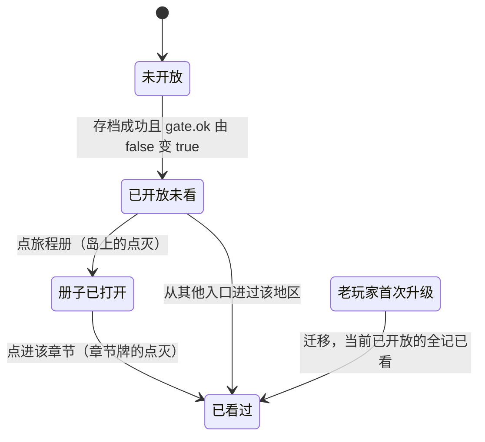
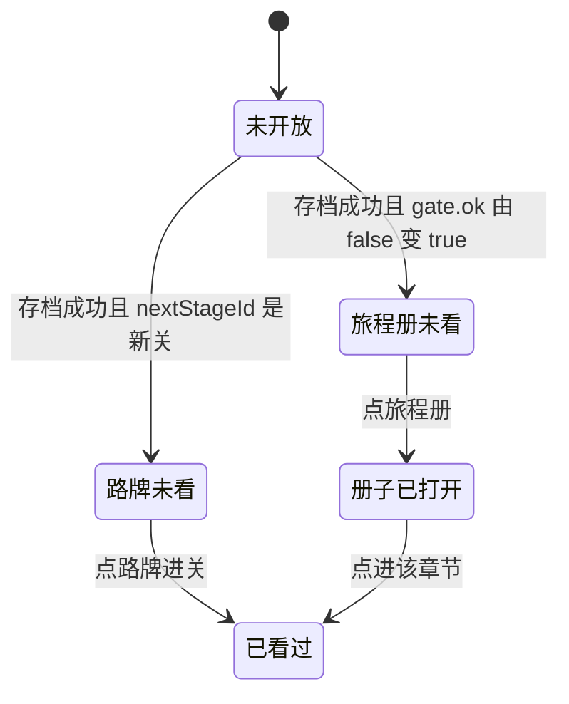

# 解锁提示改到旅程册 / 路牌上的红点（r5 U1-3）

只出交互稿和两个方案的对比，**不写代码**。

| 文件 | 内容 |
|---|---|
| `unlock_A_journal.jpg` | 方案 A：一个入口，所有解锁都汇到旅程册（四步流程） |
| `unlock_B_signpost.jpg` | 方案 B：按类型分两处，新主线关放路牌，新挑战 / 新章节放旅程册（四步流程） |
| `reddot_spec.png` | 红点样式（两个方案共用） |
| `state_A.png` / `state_B.png` | 状态图（下面也有一份 mermaid） |
| `src/render_unlock.py` | 出图脚本：`python3 docs/r5/ui/unlock/src/render_unlock.py`。底图 `src/island_390.jpg` 是本作实机岛屏截图（pm-audit C0），`src/journey_390.jpg` 是阶段一旅程册定稿图 |

## 1. 现在的解锁提示是怎么出现的（读代码的结论）
1. **结算页的一行字（已经看不到了）**
   - `ManagedMobileBoardUI.ts:912` `resultModel()` 算出 `unlockHint`。条件是主线、过关、`s.state === 'result.saved'`、`s.result.completionRecorded`，按关卡给出：
     - 主线 04（level 3）→「主线 05 与潮汐挑战已开放；前往风车草甸」
     - 主线 08（level 7）→「主线 09 与草甸挑战已开放；天空挑战需通关主线 12」
     - 主线 12（level 11）→「天空挑战已开放；天空城另有 3D 场景入口」
   - 存档出错时，这个字段会被 `hostResultError` 占用。
   - v2.2 之前，`BoardPanels.ts` 在所有奖励都领完以后，用 teal 16 pt 显示这一行（`labelRows('ResultUnlockHint', …)`）。**SPEC v2.2（`d6a0019`）把它删掉了**：页面上只允许 过关啦 / 分数 / 下一关 / 回小岛（`test_result_screen_style` 有断言）。
   - 所以基线 `bc81575` 里，`unlockHint` 照样算出来，却**没有任何地方显示**。玩家完全不知道开放了什么，`hostResultError` 也一起看不到了。
2. **旅程册的章节牌**（`ui/IslandPanels.ts:26-50` `openJourney`）
   - 锁定的章节灰显、加锁，写「挑战需通关主线 04 / 08 / 12」（`chapterMilestone`，湖畔也是 12）。
   - 解锁后显示星数和「挑战 x/4」。
   - 解锁状态来自 `WorldNativeComposition.islandGates().r5[*].ok`（`world-r2/WorldNativeComposition.ts:184`）。没有 gate 时看 `journey.records[里程碑 − 1].bestStars`。风铃湖畔的门槛是 `LAKE_GATE_RECORD = 11`。
   - 牌子上没有“新”的标记：新开放的章节和早就开放的长得一样。
3. **路牌「继续旅程」**（T9 3D 道具，`WorldIntegrationBoot.ts:569-571`）：点了直接进下一关（`enterMainline` → `nextStageId`），不提示这是新关。
4. **其他**：`IslandToast` 只用来显示「湖畔暂时没准备好」；`RegionNodeStage.openExplore` 的 `explore-unlocked` 只是一个音效钩子。都不是解锁提示。

## 2. 两个方案
红点样式两个方案共用，见 `reddot_spec.png`：
- 外观：直径 12 pt（章节牌上 10，路牌上 14），2 pt 奶油描边 `#f8f2e2`，填色 `#ce342e`（调色板里唯一允许的红）。不带数字和字。
- 动效：出现时弹一次（0 → 1.15 → 1，0.24 s），之后不动。
- 夜间：乘 K_HALF。
- 点击：红点不可点，用道具自己的热区。

### 方案 A：一个入口，所有解锁都汇到旅程册
| 项 | 内容 |
|---|---|
| 出现时机 | 存档成功（`result.saved` 且 `completionRecorded`）后算 `新开放集合 − 已看集合`。不为空时，**回到岛屏**旅程册右上角亮点（结算页上不亮，不打扰领奖） |
| 红点位置 | 岛屏：旅程册图标右上角（390×844 上约 (219, 719)）。册子里：新开放章节的章节名右侧 8 pt；新开放挑战的「挑战 x/4」标记右上角 |
| 点开后的流程 | 点旅程册 → 册子打开，**岛上的红点立刻灭** → 章节牌上的红点还在 → 点进章节页（`openChapter`）→ 这张牌的红点灭 → 章节页按钮照旧（「继续挑战」等） |
| 什么时候消失 | 岛屏的点：打开旅程册时。章节牌的点：点进那一章时；或者玩家从别的路径（路牌 / 旅途）已经进过该地区时 |
| 新开放集合 | 章节：`islandGates().r5[region].ok`、湖畔门槛；挑战：同上 gate；主线新关不单独记（主线一直走路牌，不需要提示） |
| 存储 | `localStorage` 新 key `qfl.ui.seenUnlocks`（JSON 数组，存开放项 id，比如 `chapter:meadow`、`challenge:tide`），和 `seenTools` 一样放在 `ui/UiPrefs.ts`，**不写旅程存档**（只读状态下也能用） |
| 老玩家 | 第一次带这个功能启动时，把当前已开放的全部记成已看（迁移），避免一进岛就满屏红点 |
| 优点 | 只有一个地方要找；和「挑战需通关主线 xx」的锁定文案配成一套；改动小（岛屏 1 个点 + 章节牌） |
| 缺点 | 新主线关没有提示（靠路牌本身） |

### 方案 B：按类型分两处，新主线关放路牌，新挑战 / 新章节放旅程册
| 项 | 内容 |
|---|---|
| 出现时机 | 同 A；但 `nextStageId` 变成之前没进过的主线关时，**路牌**亮点；挑战 / 章节由锁变开时，**旅程册**亮点 |
| 红点位置 | 路牌木牌右上角（390×844 上约 (368, 546)，跟着路牌投影走，T9 的 signpost 热区已经在跟）；旅程册同 A |
| 点开后的流程 | 点路牌 → 照旧直接进下一关（不加弹窗）→ 路牌的点灭。点旅程册 → 同 A |
| 什么时候消失 | 路牌：点路牌进关时。旅程册：打开册子时。章节牌：点进那一章时 |
| 存储 | 同 A，同一个 key，id 加 `stage:mainline-05` 一类 |
| 老玩家 | 同 A |
| 优点 | 新关卡的提示就在玩家本来要点的地方 |
| 缺点 | 两处红点，岛屏同时亮两个点的概率高（主线 04 / 08 过关时主线和挑战同时开放）；路牌是 3D 道具，红点要跟着投影走，入场动画（`applyIslandEntrance`）时也要一起动 |

### 推荐
**方案 A**：入口唯一，岛屏最多一个点，和 v2.2「结算页只放核心内容」的方向一致。主线新关靠路牌本身（它一直是「继续旅程」），不需要再加提示。

## 3. 状态图
方案 A（每个开放项一份，岛屏的点 = 有任何一项处在「未看」）：

方案 B：

## 4. 已知问题和待决定
1. 结算页还要不要留一行解锁文字。两个方案都去掉了，和 v2.2 一致；但 `hostResultError` 也被这一行吃掉了，**存档出错的提示现在不显示**。这个要单独处理，不能随红点一起丢掉。
2. 红点的“已看”放在 localStorage，换设备或清缓存后会重新亮一次。可以接受吗？
3. 天空城另有 3D 场景入口（level 11 的原文案提到）。这个入口要不要也亮点：方案 A 没覆盖，方案 B 可以挂在路牌上。
4. 现在的旅程册有 4 章（含风铃湖畔，`CHAPTERS`），阶段一的定稿图只有 3 章。图上按 3 章画，规则对 4 章同样适用。
