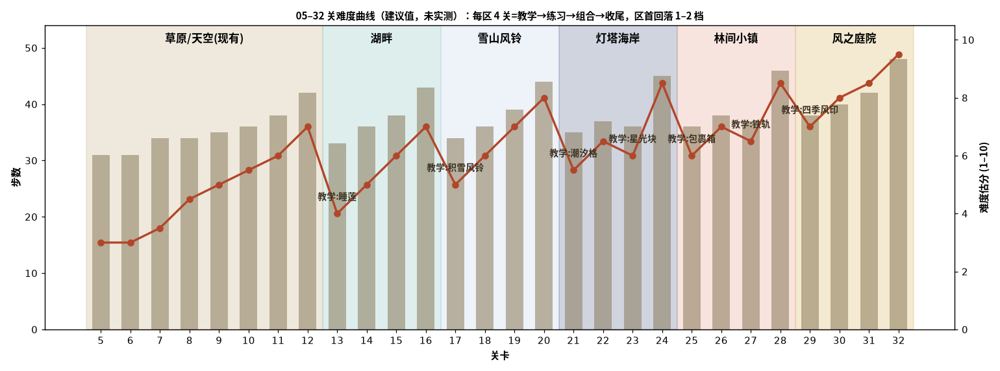

# 13–32 关难度曲线与机制引入顺序（r6 概念稿，仅建议，未改关卡数据、未实测）

## 1. 参照：05–12 的节奏和现有代码

- 节奏：每个区域 4 关，顺序是 教学 → 练习 → 组合 → 收尾。区域内每关加 0–4 步，收尾关 +4 步以上。新区域第一关难度回落 1–2 档（12 关 42 步 → 13 关建议 33 步）。
- 现有规则（`creator-build-project/assets/scripts/mainline-r1/runtime/vendor/engine.js`）：
  - **moss**：在棋子下面，消除该格就清掉，计格数。
  - **roots**：覆盖在格子上，1–3 层，相邻消除时每波掉 1 层（第 606–623 行），清零才计数。
  - **特殊块**：line_h / line_v / bomb / color。互相交换时：line+line=十字，bomb+line=3 行 3 列，bomb+bomb=5×5。
  - **道具**：bomb 3×3 两次，不耗步。
  - **级联**：受 MAX_CASCADES 封顶。
- 关卡外壳：`region-campaign.js` 读取 `moves / moss / roots / goals`，并附带 `learningBeat` 和 `strategy`。
- 结论：只有「换皮复用 roots/moss」是零代码的。其它新机制都需要引擎改动，这里只写规则，交给 Cursor 评估。

## 2. 机制引入顺序

| 顺序 | 机制 | 区域 | 教学关 | 练习关 | 引擎实现建议 | 代码量 |
|---|---|---|---|---|---|---|
| 1 | 睡莲叶盖（2/1 层覆盖） | 湖畔 | 13 | 14（再在 15/16 组合） | 复用 `roots` 并换皮 | 无 |
| 2 | 积雪风铃（2 层盖，清除时吹落同列最上 1 格雪） | 雪山 | 17 | 18 | 先按 `roots` 做；「吹落」需要在 clearWave 后加一个连锁命中 | 小 |
| 3 | 潮汐格（每 3 步涨退，涨潮时锁格） | 灯塔 | 21 | 22 | 新增按步计时的格子状态，加锁定判定，HUD 倒计时 | 中 |
| 4 | 星光块（不可移动，相邻消除 3 次后放十字光） | 灯塔 | 23 | 24 | 计数型障碍，满了生成一个 cross 效果（复用 line+line） | 中 |
| 5 | 包裹箱（占格 1–2 层，拆完计数） | 小镇 | 25 | 26 | 新增不可下落的占格障碍。注意引擎写的是 “No obstacle falls”，所以需要补上下落时的阻挡规则 | 中 |
| 6 | 铁轨连接（箱子沿轨道滑到邮筒算送达） | 小镇 | 27 | 28 | 新增轨道邻接表，在 fall() 之后加一个滑动阶段，并新增目标类型 | 大 |
| 7 | 四季风印（3 层叠盖：睡莲 → 积雪 → 封条；中心印全清后触发全盘风） | 庭院 | 29 | 30（31/32 检验） | 多层覆盖，每层换皮，规则全部来自已学机制 | 小–中 |

原则：
- 同一关最多出现 1 个新机制。
- 新机制的教学关只配 1 个旧目标、步数宽松。
- 练习关加一个旧障碍。
- 第 3 关做组合。
- 收尾关三目标，+5 步以上。

## 3. 每关建议

| 关 | 区域 | 作用 | 主目标（建议） | 步数 | 难度估分 |
|---|---|---|---|---|---|
| 13 | 湖畔 | 教学：睡莲 | 睡莲6, 蓝莓16 | 33 | 4 |
| 14 | 湖畔 | 练习：睡莲 + 苔藓 | 睡莲7, 苔藓8, 贝壳16 | 36 | 5 |
| 15 | 湖畔 | 组合：睡莲 + 特殊块 | 睡莲12, 特殊3, 花16 | 38 | 6 |
| 16 | 湖畔 | 收尾 | 睡莲17, 苔藓9, 草莓20 | 43 | 7 |
| 17 | 雪山 | 教学：积雪风铃 | 积雪8, 青叶16 | 34 | 5 |
| 18 | 雪山 | 练习：积雪 + 苔藓 | 积雪10, 苔藓10, 橡果16 | 36 | 6 |
| 19 | 雪山 | 组合：积雪 + 根须（雪山的根须是枯枝皮） | 积雪10, 根须6, 特殊3 | 39 | 7 |
| 20 | 雪山 | 收尾 | 积雪14, 根须8, 花20 | 44 | 8 |
| 21 | 灯塔 | 教学：潮汐（只有底行） | 苔藓10, 蓝莓18 | 35 | 5.5 |
| 22 | 灯塔 | 练习：潮汐（两行交替） | 苔藓12, 根须6, 贝壳18 | 37 | 6.5 |
| 23 | 灯塔 | 教学：星光块 ×2（潮汐只保留 1 行） | 星光2, 草莓18 | 36 | 6 |
| 24 | 灯塔 | 练习/收尾：潮汐 + 星光 ×4 | 星光4, 苔藓12, 青叶20 | 45 | 8.5 |
| 25 | 小镇 | 教学：包裹箱 | 包裹6, 橡果18 | 36 | 6 |
| 26 | 小镇 | 练习：包裹（2 层）+ 根须 | 包裹8, 根须6, 花18 | 38 | 7 |
| 27 | 小镇 | 教学：铁轨（1 条，2 个箱） | 送达2, 蓝莓18 | 37 | 6.5 |
| 28 | 小镇 | 练习/收尾：铁轨 ×2 + 包裹 | 送达4, 包裹6, 草莓20 | 46 | 8.5 |
| 29 | 庭院 | 教学：四季风印 ×4 | 风印4, 苔藓10 | 38 | 7 |
| 30 | 庭院 | 练习：风印 + 潮汐 | 风印6, 星光2, 花20 | 40 | 8 |
| 31 | 庭院 | 组合检验：包裹 + 风印 + 苔藓 | 风印6, 包裹6, 苔藓12 | 42 | 8.5 |
| 32 | 庭院 | 终章 | 风印8, 送达2, 星光2, 草莓22 | 48 | 9.5 |

注：难度估分是根据目标量、步数和机制数量人工给的，没有经过模拟器或真人试玩。正式上线前应该用 `tools/region-levels` 的求解与回归测试跑一遍。
